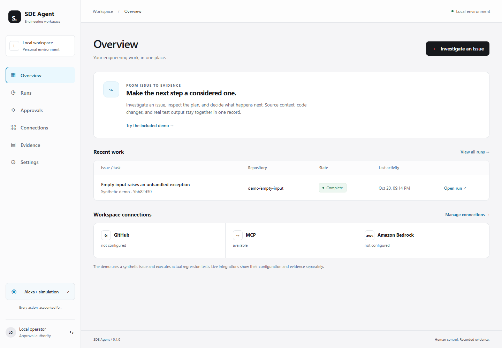
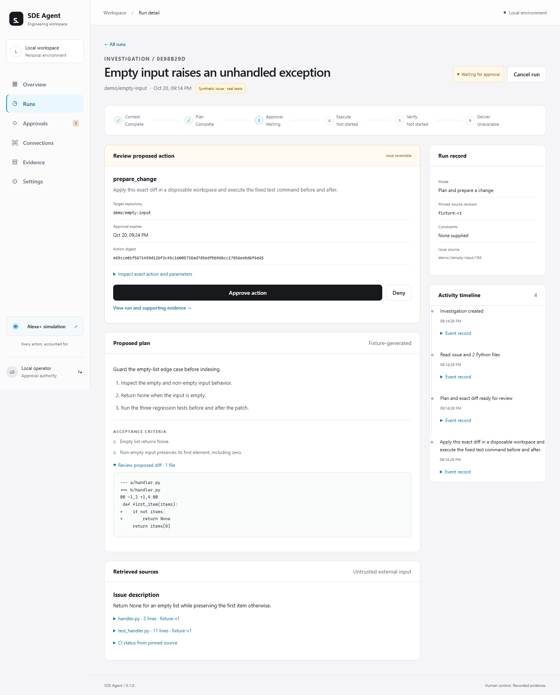
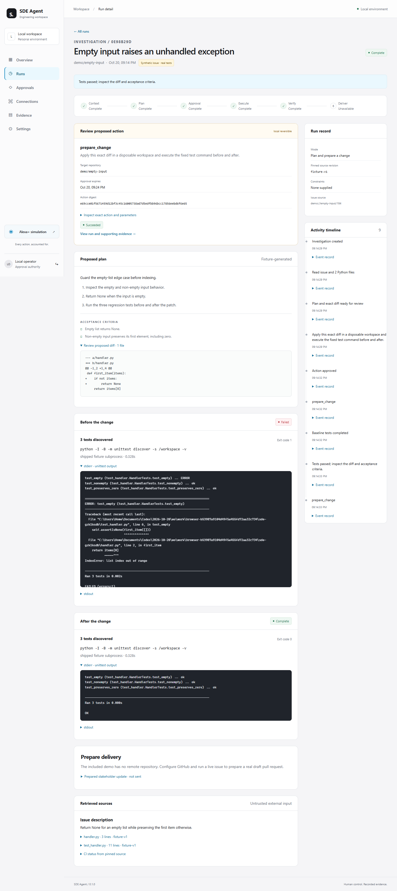
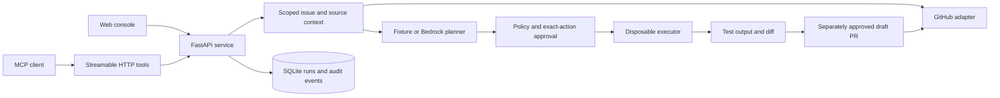

# SDE Agent Starter Kit

**From issue to reviewed change, with every action and result accounted for.**

[](https://github.com/udbhav-metla/sde-agent-starter-kit/actions/workflows/checks.yml)

SDE Agent is a local engineering workflow console. It brings issue context, a proposed plan, an exact diff, human approvals, test output, and delivery evidence into one persistent record. The model proposes work; deterministic backend policy controls execution.

[Quick start](#quick-start) · [Demo](#try-the-demo) · [Architecture](#architecture) · [Integrations](#live-integrations) · [Documentation](#documentation)



## What it does

- **Investigates an issue:** collects scoped GitHub issue data, Python files, and CI check metadata at a pinned commit.
- **Proposes a bounded change:** shows the plan, acceptance criteria, affected files, and complete proposed diff.
- **Pauses for exact-action approval:** binds each decision to its payload, repository, actor, digest, and expiry.
- **Records actual verification:** presents before/after stdout, stderr, exit codes, test counts, and duration.
- **Prepares delivery:** requests separate approval for a new branch and draft PR containing the tested patch.
- **Keeps an audit trail:** persists runs, source references, decisions, outcomes, and a hash-linked timeline.
- **Exposes MCP tools:** provides seven typed capabilities through the official SDK's Streamable HTTP transport.

### Current status

This is a runnable local MVP. An implemented adapter is distinguished from a verified live integration.

| Capability | Status |
|---|---|
| Dashboard, plans, approvals, history, and evidence | Implemented; desktop/mobile browser workflow checked |
| Included demonstration | Synthetic issue and deterministic plan; actual regression tests executed |
| Server-side policy and approval lifecycle | Denial, expiry, stale parameters, cancellation, and replay tested |
| MCP transport | Official SDK initialization, discovery, calls, and reconnect verified |
| GitHub issue/context and draft-PR adapters | Implemented; live application path requires scoped credentials |
| Amazon Bedrock Converse planner | Implemented; mocked provider contract tested; live AWS call pending |
| Docker executor for external code | Implemented; real container isolation not verified in the build environment |
| Alexa+ | Labelled text simulation; no live Alexa connection |
| Upstream open-source contribution | Not yet supplied |

**Recorded checks:** 32 automated tests passed, plus MCP SDK interoperability, desktop/mobile browser checks, Python compilation, and wheel build. Inspect the [captured evidence](evidence/README.md); the badge above reports the current hosted workflow result.

## Quick start

**Requires Python 3.12.** The included demo needs no GitHub token, AWS account, or Docker after dependencies are installed.

```bash
git clone https://github.com/udbhav-metla/sde-agent-starter-kit.git
cd sde-agent-starter-kit
```

### Windows PowerShell

```powershell
python -m venv .venv
.\.venv\Scripts\python.exe -m pip install -r requirements.lock
.\.venv\Scripts\python.exe -m sde_agent
```

### macOS or Linux

```bash
python3.12 -m venv .venv
.venv/bin/python -m pip install -r requirements.lock
.venv/bin/python -m sde_agent
```

Open the private login link printed in your terminal. The service listens on **`http://127.0.0.1:8000`**. Its link fragment contains the local operator token; keep that link out of public screenshots and logs. The browser stores the token for its session and removes it from the address bar.

Use `python -m sde_agent --port 8080` with your virtual environment's Python for a different port. Stop the service with **Ctrl+C**.

## Try the demo

1. Select **Try the included demo** on the overview.
2. Keep **Plan and prepare a change** selected, then choose **Build a plan**.
3. Inspect the synthetic issue, source, acceptance criteria, proposed diff, and exact action payload.
4. Choose **Approve action**. The original empty-input handler fails a regression test; the patched version passes all three fixture tests.
5. Compare the recorded output and inspect the timeline.
6. Start another run and choose **Deny** to show that the protected action does not execute.

Choose **Plan only** to inspect a plan without modifying code or running tests. The fixture has no remote repository, so the UI does not invent a pull-request URL.

<details>
<summary>Approval and verification screenshots</summary>





</details>

## Architecture



The dashboard is JavaScript and CSS served by the backend. FastAPI and Pydantic define the HTTP contract; SQLite WAL persists local records; two bounded worker threads handle active operations. The official MCP Python SDK provides the tool transport. Bedrock is an optional planning adapter.

## Live integrations

Copy [`.env.example`](.env.example) to `.env`, configure the values locally, and restart. Never commit credentials.

| Setting | Purpose |
|---|---|
| `SDE_ALLOWED_REPOS` | Exact, comma-separated `owner/repository` allowlist |
| `GITHUB_TOKEN` | Fine-grained token scoped to a disposable target repository |
| `SDE_GITHUB_WRITE` | Defaults to `false`; enable when draft-PR publication is needed |
| `AWS_REGION` / `BEDROCK_MODEL_ID` | Explicit region and accessible model or inference profile |
| `SDE_SANDBOX_IMAGE` | Pre-pulled Docker image; use an audited digest for sensitive environments |
| `SDE_API_TOKEN` | Optional fixed local operator token; otherwise generated at startup |
| `SDE_DATA_DIR` | Local data directory; defaults to `.data` |

The live flow retrieves an allowed issue, requests approval before sending context to Bedrock, shows a proposed patch, requests approval for preparation and tests, and finally requests separate approval for a draft PR. Model output cannot choose commands or grant permissions.

GitHub reads need Metadata, Issues, Checks, and Contents read access. Publication additionally needs Contents and Pull requests write access. AWS uses the standard boto3 credential chain; adapt the [example IAM policy](infra/bedrock-policy.example.json) to the selected model and region.

No cloud resources are provisioned. Bedrock makes one bounded request per approval without an automatic provider retry. Set an account budget before enabling it. See the [operations guide](docs/OPERATIONS.md) for permissions, limits, setup, and recovery.

## MCP and Agent Skill

**Endpoint:** `http://127.0.0.1:8000/mcp/`  
**Authentication:** `Authorization: Bearer <local operator token>`  
**Transport:** Streamable HTTP, stateless, JSON responses; MCP SDK 1.30.0 handles protocol negotiation.

| Tool | Purpose |
|---|---|
| `get_issue` | Read retrieved issue context and source identity |
| `search_repository` | Search pinned source with file and line locators |
| `read_file` | Read an already retrieved file, never an arbitrary host path |
| `get_ci_status` | Inspect retrieved CI check metadata |
| `propose_change` | Inspect the plan, diff, and approval state |
| `run_tests` | Read actual test evidence; cannot launch arbitrary commands |
| `create_draft_pull_request` | Prepare a remote-write approval rather than publish immediately |

Create a run through the dashboard first, then use its run ID. Protected actions require dashboard review; there is no MCP approval-decision tool. The [investigation skill](skills/investigate-fix/SKILL.md) describes the reusable workflow. Invocation in a separate skill-host ecosystem has not yet been verified.

## Security boundaries

- External issue text, code, logs, and model output are untrusted data. Authorization is enforced server-side.
- Approvals expire after ten minutes, bind to exact parameters, and are consumed once.
- Unknown tools, invalid schemas, unsafe paths, foreign hosts/origins, and out-of-scope repositories are rejected.
- External code has no host-shell fallback. Docker runs without network, mounted credentials, root privileges, or a host Docker socket inside the container.
- Execution uses a fixed unittest command, read-only filesystem, 256 MB memory, one CPU, 32 PIDs, and 45 seconds per check.
- Nonzero exits and zero discovered tests cannot produce successful verification.
- Configured secrets and recognized secret patterns are redacted. Filtering is heuristic; use non-sensitive disposable repositories.
- Audit records have append-only SQL triggers and a hash chain, without an externally anchored tamper-proof guarantee.

## Testing

From an activated virtual environment:

```bash
python -m pytest -q
```

Tests cover the fixture workflow, plan-only mode, approval denial/expiry/replay, stale payloads, cancellation, authentication, path traversal, secret canaries, timeout termination, zero-test discovery, and mocked provider contracts.

With the service running and `SDE_API_TOKEN` set locally:

```bash
python scripts/verify_mcp.py
```

Use `SDE_BASE_URL` for another local port. For optional browser checks, run `npm install`, `npx playwright install chromium`, and `npm run test:browser` against the running service. The browser check writes screenshots under `evidence/`.

## Repository layout

```text
.github/workflows/       Hosted automated test workflow
sde_agent/               Backend, orchestration, policy, integrations, storage
  web/                   Dashboard HTML, JavaScript, CSS, and assets
tests/                   Workflow, security, and provider-contract tests
docs/                    Original specifications, status, API schema, operations
skills/investigate-fix/  Reusable MCP investigation skill
infra/                   Example least-privilege AWS configuration
scripts/                 MCP client and browser verification entry points
evidence/                Captured reports and screenshots
```

## Documentation

| Guide | Contents |
|---|---|
| [Documentation map](docs/README.md) | Index of the supplied specifications and implementation guides |
| [Implementation status](docs/21_IMPLEMENTATION_STATUS.md) | Decisions, coverage, and remaining release gates |
| [Operations](docs/OPERATIONS.md) | Detailed setup, permissions, limits, reset, and failure recovery |
| [HTTP contract](docs/api.openapi.json) | Exported OpenAPI schema; live schema is at authenticated `/openapi.json` |
| [Evidence](evidence/README.md) | Test reports, MCP results, and screenshots |
| [Contributing](CONTRIBUTING.md) | Contribution scope, security expectations, and validation |

## Current limits

This release is a **single-user local service**, with one process per data directory. Multi-user hosting needs additional identity and role controls. Live execution supports small Python standard-library projects with unittest discovery: at most 40 supported source/test files and 300 KB retrieved source. Dependency installation, arbitrary commands, other languages, and test-file changes are unsupported.

Live application GitHub calls, Bedrock calls, and Docker isolation still need verification in the owner's setup. Tests passing do not prove every acceptance criterion. Interrupted remote writes are marked partial and must be reconciled against GitHub before retrying. Local records remain until an explicit reset; stop the service and remove only its configured data directory after exporting needed evidence.

Merges, deployments, sent stakeholder messages, live Alexa access, and an upstream contribution are outside the implemented release. Publishing this repository alone does not satisfy the upstream contribution requirement.

## License and attribution

The owner has not selected a project license. This repository does not currently grant an open-source license. Third-party dependencies retain their own licenses.

Implementation references: [MCP Python SDK](https://github.com/modelcontextprotocol/python-sdk), [Amazon Bedrock Converse](https://docs.aws.amazon.com/boto3/latest/reference/services/bedrock-runtime/client/converse.html), and [GitHub REST API](https://docs.github.com/en/rest).
